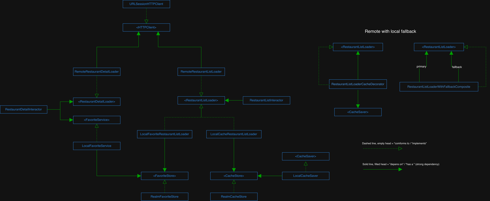

# RestaurantApp

An iOS app for browsing restaurants, built for the Dicoding iOS Expert submission. Data comes from the [Dicoding Restaurant API](https://restaurant-api.dicoding.dev). You can search, open a restaurant's details, and save favorites. The last successful restaurant list is cached, so the list still loads when you're offline.

## Features

- Restaurant list with search
- Restaurant detail screen
- Favorites, stored locally
- Offline fallback: if the network request fails, the list loads from the local cache

## Architecture

The project is split into two modules.

- **RestaurantApp**: the iOS app target. UI and presentation, organised per screen as VIPER (View, Interactor, Presenter, Router). Dependencies are wired in [`Container.swift`](RestaurantApp/RestaurantApp/Modules/DI/Container.swift) using Factory.
- **RestaurantCore**: a framework with the business logic. It holds the entities, the remote and local loaders, and the HTTP and persistence infrastructure. It has no UI code, and the app only depends on its protocols.



The editable diagram is on [Google Drive (draw.io)](https://drive.google.com/file/d/1mrckJRRSyWa454yGtHkO2o3hofq1os9t/view?usp=sharing).

### Loading the restaurant list

`restaurantListLoader` is a composition of small objects, each with one job:

```
RestaurantListLoaderWithFallbackComposite
├── primary:  RestaurantListLoaderCacheDecorator
│             ├── decoratee: RemoteRestaurantListLoader  (HTTP via URLSessionHTTPClient)
│             └── cache:     LocalCacheSaver             (Realm via RealmCacheStore)
└── fallback: LocalCacheRestaurantListLoader             (Realm via RealmCacheStore)
```

1. The remote loader fetches the list.
2. On success, the decorator saves the result to the cache and passes it on.
3. On failure, the composite falls back to the cached list.

Favorites use the same loader protocol (`LocalFavoriteRestaurantListLoader` on top of `RealmFavoriteStore`), so the list screen can show either source.

### Project layout

```
RestaurantApp/
├── RestaurantApp/              App target
│   ├── App/                    AppDelegate, SceneDelegate
│   └── Modules/
│       ├── DI/                 Factory container
│       ├── Tabbar/             Tab bar and app router
│       ├── RestaurantList/     VIPER module
│       └── RestaurantDetail/   VIPER module
└── RestaurantCore/             Framework
    ├── Entity/
    ├── Services/
    │   ├── Remote/             API loaders, NetworkError
    │   ├── Local/              Cache and favorite services
    │   └── Decorator/          Cache decorator, fallback composite
    └── Infrastructure/         URLSession client, Realm stores
```

## Tech stack

- Swift, UIKit, minimum iOS 17.6
- [RxSwift](https://github.com/ReactiveX/RxSwift) for async work
- [Realm](https://github.com/realm/realm-swift) for the cache and favorites
- [Factory](https://github.com/hmlongco/Factory) for dependency injection
- [Kingfisher](https://github.com/onevcat/Kingfisher) for image loading
- SwiftLint
- Dependencies are added through Swift Package Manager

## Getting started

Requires Xcode with an iOS 17.6+ SDK.

```sh
git clone <repo-url>
cd RestaurantApp
open RestaurantApp.xcworkspace
```

Open the **workspace**, not the individual `.xcodeproj`, so both modules build together. Xcode resolves the packages on first open. Pick the `RestaurantApp` scheme and run.

## Tests

Both modules have unit tests. Run them in Xcode with `Cmd+U`, choosing the `RestaurantApp` or `RestaurantCore` scheme.

- **RestaurantCore**: loaders, decorators, the composite, and the Realm and URLSession infrastructure. The core logic is tested against spies (`HTTPClientSpy`, `CacheStoreSpy`, `FavoriteStoreSpy`).
- **RestaurantApp**: interactors and presenters for the list and detail modules.
